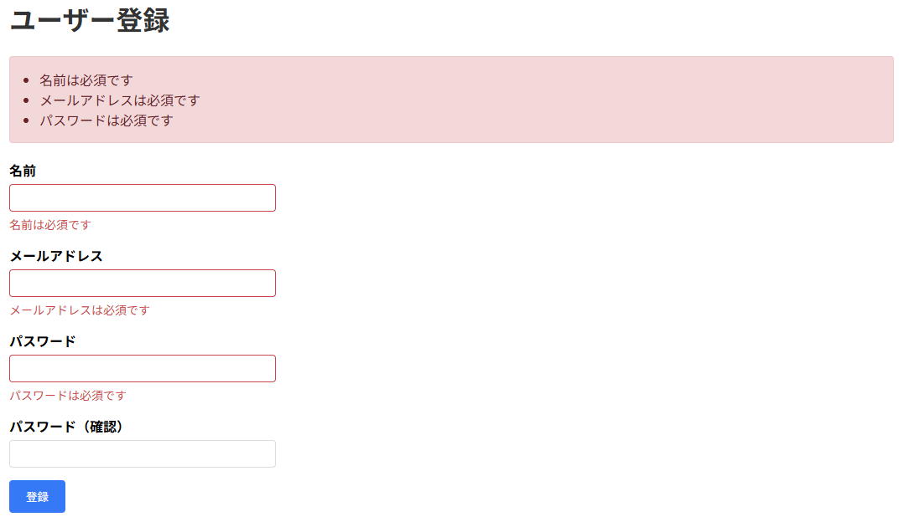
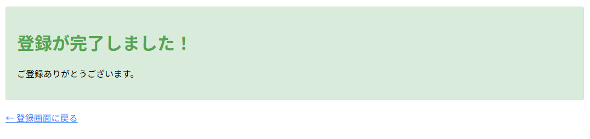

# validation-app-practice

## 概要
COACHTECH 教材 Tutorial 9-6「バリデーション ハンズオン演習」で作成した成果物です。
ユーザー登録画面で名前、メールアドレス、パスワードの各項目に入力した値をバリデーションルールと照合する仕組みを実装しました。バリデーションエラーがあれば指定したエラーメッセージを表示し、全てのバリデーションルールを満たせば登録完了画面に遷移します。

## 使用技術
- PHP 8.5.12
- Laravel 10.50.4
- FormRequest / バリデーションルール

## 学んだこと
- validate()メソッドにより入力内容に対してバリデーションルールに基づいた確認を行う方法
- バリデーションエラー時に指定したエラーメッセージを表示する方法
- フォームリクエストの作成により、コントローラーからバリデーションの部分を分離する方法

## 動作確認
1. validation-app-practiceディレクトリ上でsail up -dコマンドによりyamlファイルに記述した構成通りのコンテナを起動させてネットワークで連携
2. sail artisan migrateコマンドによりテーブルを作成
3. ブラウザで「`http://localhost/register`」のURLにアクセスしてユーザー登録画面が表示されることを確認
4. 名前、メールアドレス、パスワードの各項目に対して以下を確認する  
   - 名前が空欄、または51文字以上の時にエラー表示
   - メールアドレスが空欄、メールアドレスの形式になっていない、既に登録されている時にエラー表示
   - パスワードが空欄、8文字未満、パスワード（確認）と異なるときにエラー表示
5. 登録が成功すると登録完了画面に遷移し、「←登録画面に戻る」押下でユーザー登録画面に戻る

## 詰まったポイントと解決方法
- Userモデルクラスのcreateメソッドを呼び出しているのに、モデルをインポートできておらずエラーが出た  
  ┗モデルのパスをもとに正常にインポート、またパスワードのハッシュ化のためにHashをインポートした

## 開発の工夫
- 提供されたBladeファイルを確認し、formタグの送信先やanchorタグの遷移先の指定にルート名が指定されていたため、それを基にルーティングの際にルート名を設定した
- バリデーションをフォームリクエスト側が担うことで、コントローラー内のコードの可読性が向上するように実装した

## 教材の書き方との違いによる学び
- 自分のコードでは、Hash::make()を使用してパスワードを明示的にハッシュ化していた。一方、Userモデル内でpassword属性に対するhashedキャストが標準で設定されていて、パスワードが自動的にハッシュ化される仕組みになっていたため、教材ではハッシュ化の処理が記述されていなかった  
┗モデル側の設定によって、コントローラーで明示的にハッシュ化しなくても安全にパスワードを保存することができる

## 動作確認のスクリーンショット
1. バリデーションエラーが発生した時の画面

   

2. バリデーションを通過してユーザー登録が完了した時の画面

   